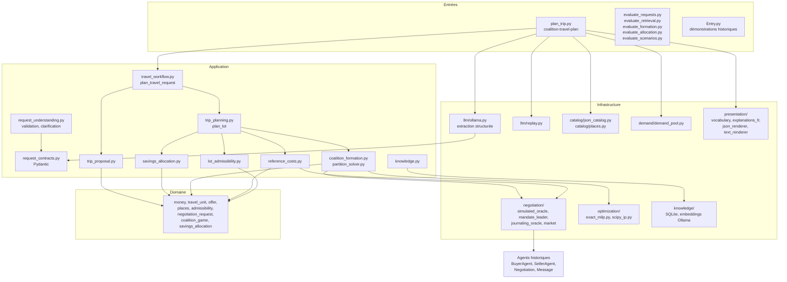
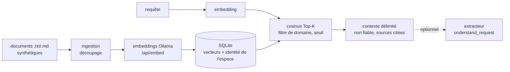

# Architecture finale de CoalitionTravel

Ce document décrit l'architecture **telle qu'elle est dans le code** au commit audité,
puis l'architecture cible, qui n'est pas réalisée. Les noms de fichiers sont relatifs à
`Multi-Agent/coalition_travel/`.

---

## 1. Périmètre

CoalitionTravel est une **plateforme expérimentale locale** de simulation de
négociation et de formation de coalitions de voyageurs.

- **Données fictives :** les fournisseurs, les prix et les places sont fictifs, dans
  des catalogues figés par manifeste.
- **Résultat simulé :** le résultat est une *proposition simulée*. Rien n'est réservé,
  payé ni émis.
- **Exécution locale :** les agents (acheteurs, vendeurs, mandataire de groupe)
  échangent des messages **dans un seul processus Python, de façon synchrone**. Le
  système n'est pas distribué.

## 2. Composants



**Règles de dépendance :**

- le domaine n'importe ni l'application ni l'infrastructure ;
- l'application n'importe pas l'infrastructure. `REPLAY_FORMAT_VERSION` est défini dans
  l'application pour cette raison ;
- les modules qui décident des prix, des offres, des coalitions et des paiements
  n'importent pas la couche RAG (`tests/test_final_hostile_context.py`).

## 3. Séquence d'une demande

```mermaid
sequenceDiagram
    actor P as Personne
    participant C as plan_trip (CLI)
    participant X as Extracteur (Ollama ou rejeu)
    participant V as Validation
    participant L as PlaceDirectory
    participant W as plan_travel_request
    participant N as Oracle simulé (agents P3)
    participant F as P4 (formation)
    participant A as P5 (allocation)
    participant R as Rendus

    P->>C: texte ou --draft-json
    C->>X: texte + date de référence
    X-->>C: TravelRequestDraft (Pydantic)
    C->>C: règle lexicale (mots interdits)
    C->>L: résolution des lieux (alias)
    C->>V: validate_request_draft
    alt needs_clarification (au plus 3 tours)
        V-->>C: champs manquants
        C->>P: question
        P-->>C: réponse
    end
    C->>C: choix catalogue v1/v2 et carnet ; ouverture du marché
    C->>P: résumé, question de validation
    P-->>C: oui (ou --yes)
    C->>W: demande validée + carnet
    W->>W: profils, unités, admissibilité, H2
    W->>N: références individuelles (négociations solo)
    W->>F: candidats, négociations collectives, partition exacte
    F->>N: négociations (cache, journaux)
    W->>A: Shapley exact, projection, centimes
    W-->>C: TripPlan + TripProposal
    C->>R: JSON canonique ou texte
    R-->>P: proposition simulée
```

## 4. Frontières du workflow

| # | Étape | Entrée | Sortie | Erreurs | Invariants | Données | Responsable |
|---|---|---|---|---|---|---|---|
| 1 | Extraction | texte, date | `TravelRequestDraft` | `LLMProviderError` et `StructuredOutputError` : techniques, code 1 | le LLM n'extrait que des faits ; schéma JSON imposé ; champs inattendus refusés | prompt versionné `travel-request-extraction-v2` | `infrastructure/llm/ollama.py`, `replay.py` |
| 2 | Validation | brouillon | `ready`, `needs_clarification` ou `invalid` | messages fermés ; code 2 ou 3 | règles déterministes | — | `application/request_understanding.py` |
| 3 | Clarification | champs manquants | brouillon complété | fin d'entrée : code 2 ; Ctrl-C : code 130 | au plus 3 tours | — | `plan_trip.py` |
| 4 | Lieux | noms saisis | clés canoniques | `unknown_place` : code 2 | alias sans collision | `places_v1.json` | `domain/places.py` |
| 5 | Sélection v1/v2 | brouillon | chemins du catalogue et du carnet | — | v2 si et seulement si un champ de trajet est présent (D-I4-1) | manifestes | `plan_trip.py` |
| 6 | Chargement | fichiers | `OfferCatalog`, `DemandPoolSnapshot` | `CatalogValidationError`, `DemandPoolError` : code 1 | SHA-256 égal au manifeste ; C1 à C6 | catalogues, carnets | `infrastructure/catalog`, `demand` |
| 7 | Profils | brouillon | profils effectifs | — | effectifs cohérents ; consolidation par clé | — | `application/profiles.py` |
| 8 | Unités | profils | `TravelUnit` | `TravelUnitError` | unité indivisible ; empreinte d'unité | — | `application/travel_units.py` |
| 9 | Admissibilité | unités × offres | paires admissibles et motifs | `LotInputError` (lot mixte, K9) | règles ordonnées ; court-circuit de route | — | `domain/admissibility.py`, `lot_admissibility.py` |
| 10 | Capacités H2 | lot | `optimizable` ou `capacity_model_violated` | — | demande ≤ capacité de chaque offre | — | `lot_admissibility.py` |
| 11 | Références | unités admissibles | coût solo minimal | — | une négociation par paire ; accord strictement positif | planchers privés | `reference_costs.py` |
| 12 | Cache | clés de requête | réponse mise en cache | `NonDeterministicJournalError` | une clé, une réponse ; journaux J1 à J5 | — | `negotiation_cache.py`, `journaling_oracle.py` |
| 13 | Négociation | requête de négociation | issue et journal | issues typées | `terminal_reason` cohérent | termes vendeurs privés | `infrastructure/negotiation/` |
| 14 | Formation P4 | candidats et coûts | partition optimale | `PartitionInvalid`, `component_too_large` | partition exacte ; valeur égale entre méthodes croisées | — | `coalition_formation.py`, `partition_solver.py` |
| 15 | Allocation P5 | blocs | paiements en centimes | `AllocationPreconditionError` | Σ paiements = coût ; 0 ≤ y ≤ ref ; aucun appel d'oracle | — | `savings_allocation.py` |
| 16 | Proposition | plan | `TripProposal` v1 ou v2 | `ProposalConsistencyError` | codes fermés ; aucun objet privé | — | `trip_proposal.py` |
| 17 | Présentation | proposition | JSON canonique ou texte | — | vocabulaire contrôlé ; aucun chemin ni empreinte privée | — | `infrastructure/presentation/` |

**Codes de sortie de la commande :**

| Code | Sens |
|---|---|
| 0 | proposition produite |
| 1 | erreur technique |
| 2 | clarification nécessaire |
| 3 | demande invalide |
| 4 | demande non validée par la personne |
| 64 | usage incorrect |
| 130 | interruption |

## 5. Modèle mathématique

### 5.1 P4 : formation exacte

Notations :

- `N` : les unités admissibles d'un lot ;
- `ref_i` : le coût solo négocié de l'unité `i` ;
- `c(S)` : le coût négocié d'une coalition `S` sur une offre commune admissible ;
- `c(S) = +∞` si aucun accord n'existe ou si la capacité est dépassée.

```
v(S) = Σ_{i∈S} ref_i − c(S)          (économie de la coalition)
max  Σ_{S∈π} v(S)    sur les partitions π de chaque composante
```

- **Méthodes :** la programmation dynamique (`dp`) ou `idp_search` explore les
  partitions. Le MILP de partitionnement (`exact_milp.py`, HiGHS via SciPy) sert de
  contrôle croisé.
- **Égalité exigée :** les valeurs optimales doivent être identiques entre méthodes.
- **Départage :** à valeur égale, l'ordre est déterministe (pénalité K = nombre de
  joueurs de la composante).
- **Taille bornée :** au-delà de `max_component_units`, le statut est
  `component_too_large`, sans approximation.

### 5.2 P5 : allocation exacte

Pour un bloc `C` :

1. **Valeur de Shapley exacte** sur le jeu de couverture `v*`, en rationnels
   (`fractions.Fraction`), calculée dans `domain/savings_allocation.py`.
2. **Projection** sur `{ y : Σ y_u = v*(C), 0 ≤ y_u ≤ ref_u }`. C'est la projection
   euclidienne, avec `θ_u = 0` (addendum ID-6). Elle n'est active que si un `φ_u`
   sort des bornes.
3. **Paiement :** `x_u = ref_u − y_u`, arrondi au centime par la méthode du plus fort
   reste.
4. **Répartition par voyageur :** égalité contrainte par les budgets,
   `q_s = min(b_s, τ)`.

**Garanties testées :**

- `Σ x_u = c(C)` ;
- `0 ≤ x_u ≤ ref_u ≤ budget` ;
- aucun appel d'oracle en P5.

## 6. Contrats publics

| Contrat | Rôle | Fermé |
|---|---|---|
| `TravelRequestDraft` (Pydantic) | sortie d'extraction | oui : champs inattendus refusés |
| `trip-proposal-v1` / `-v2` | proposition publique | oui : noms de champs figés (T-CONF-3) |
| `trip-request-status-v1` / `-v2` | statuts sans proposition | oui : clés et valeurs (domaine E) |
| `negotiation-request-key-v2` / `-v3` | clés économiques | v3 seulement pour une route ; v1 identique octet pour octet |
| `p4-formation-report-v1` | strates P4 | empreintes reproductibles |
| `p5-allocation-v1` | allocation | `allocation_sha256` |
| `economic-scenarios-v1` | scénarios économiques de référence | oui |

## 7. RAG



Le RAG est un système **documentaire** :

- il n'intervient ni dans les prix, ni dans les offres, ni dans la disponibilité, ni
  dans les coalitions ;
- il n'est pas branché sur `coalition-travel-plan` ;
- un index est propre à un modèle et à une configuration : la base refuse un autre
  espace d'embedding.

## 8. Architecture réelle et architecture cible

| Aspect | Réel | Cible (non réalisée) |
|---|---|---|
| Communication entre agents | appels de méthodes dans un processus, boucle synchrone (`Negotiation.py`) | messages asynchrones (XMPP/SPADE ou file de messages), identités, temporisations, idempotence par clé de requête |
| Disponibilité fournisseur | catalogue figé | adaptateur de disponibilité, hors du LLM |
| Interface | CLI | API typée, puis interface sans logique métier |
| Stockage | fichiers versionnés, SQLite pour le RAG | inchangé tant que le volume reste local |

La clé de requête économique (`negotiation-request-key-v2` / `-v3`) et les journaux
déterministes sont les points d'appui d'une future distribution : ils fournissent
l'idempotence d'une négociation et la vérification de son journal.
