# Audit final du projet — étape 0

**Date :** 2026-11-20.
**Commit audité :** `5d547ec18a10965f52f1572296cfdd7dd95fa79f` (branche
`p1-coalition-foundations`, identique à `github/p1-coalition-foundations`).
**Arbre de travail au début de l'audit :** aucune modification suivie ; les 18 fichiers
personnels sont présents, non suivis, et n'ont jamais été commités.

Chaque résultat porte sa nature :

- **[E]** : exécuté dans cet audit, avec la commande donnée ;
- **[R]** : rapporté par une phase précédente, preuve présente dans le dépôt ;
- **[H]** : hypothèse non vérifiée.

---

## 1. Ce qu'est réellement le projet

CoalitionTravel est une **plateforme expérimentale locale** :

- elle simule la négociation entre agents acheteurs et vendeurs ;
- elle forme des coalitions de voyageurs.

Les fournisseurs, les prix et les offres sont fictifs. Une proposition est une
**simulation** : rien n'est réservé, payé ni émis. Les agents communiquent dans
**un seul processus Python, de façon synchrone**. Le système n'est pas distribué.

## 2. Architecture observée

```mermaid
flowchart LR
    U[Texte ou brouillon JSON] --> X{Extraction}
    X -->|Ollama, prompt v2| L[OllamaStructuredRequestExtractor]
    X -->|rejeu| R[ReplayStructuredRequestExtractor]
    X -->|--draft-json| D[TravelRequestDraft]
    L --> D
    R --> D
    D --> V[validate_request_draft<br/>ready / needs_clarification / invalid]
    V --> P[PlaceDirectory<br/>résolution des lieux]
    P --> S{v1 ou v2 ?}
    S --> C[(catalogue v1/v2<br/>carnet de demandes v1/v2)]
    C --> T[plan_travel_request]
    T --> A[profils, unités, admissibilité]
    A --> RC[références individuelles<br/>négociation P3 simulée]
    RC --> F[formation P4 exacte]
    F --> AL[allocation P5 exacte]
    AL --> TP[TripProposal v1/v2]
    TP --> O[rendu texte / JSON]
```

**Couches.** Elles suivent `Multi-Agent/coalition_travel/` :

| Couche | Rôle | Fichiers |
|---|---|---|
| `domain/` | règles métier pures : argent, unités, offres, admissibilité, clés, jeux coopératifs, Shapley exact | 17 |
| `application/` | orchestration, contrats Pydantic, validation, P4, P5, proposition | 23 |
| `infrastructure/` | catalogue JSON, oracle simulé, MILP SciPy, Ollama, RAG SQLite, rendus | 34 |
| racine `Multi-Agent/` | agents historiques (`Entry.py`, `BuyerAgent`, `SellerAgent`, `Leader`, `BrokerAgent`…) et commandes | 15 |

**Points d'entrée.** Ils sont déclarés dans `pyproject.toml` et vérifiés avec `--help`
[E] :

| Commande | Rôle |
|---|---|
| `coalition-travel` (`Entry:run_scenarios`) | démonstrations historiques, figées par le golden master |
| `coalition-travel-plan` (`plan_trip:main`) | chaîne complète, de la demande à la proposition simulée |
| `coalition-travel-eval` (`evaluate_requests:main`) | évaluation de l'extraction et des profils |
| `coalition-travel-eval-rag` (`evaluate_retrieval:main`) | évaluation du retrieval |
| `Multi-Agent/evaluate_formation.py` (non installé) | strates P4 `performance` et `exploratory` |
| `Multi-Agent/evaluate_allocation.py` (non installé) | mesures P5 M0 à M2 |

## 3. Matrice d'état

| Fonction | Implémentée | Testée | Exécutée réellement | Limites |
|---|---|---|---|---|
| Extraction LLM, Ollama, prompt v2 | oui, `infrastructure/llm/ollama.py` | oui, transport simulé | **non** : Ollama absent de la machine | aucun score réel ; le texte du prompt v1 n'existe plus que dans l'historique Git |
| Rejeu de brouillons | oui, `infrastructure/llm/replay.py` | oui | oui [E] | rejoue des sorties, n'évalue pas un modèle |
| Validation et clarification | oui, `application/request_understanding.py` | oui | oui [E] | |
| Résolution des lieux | oui, `domain/places.py`, `infrastructure/catalog/places.py` | oui | oui [E] (alias « Algiers ») | 3 lieux |
| Catalogues v1 et v2, carnets, manifestes | oui | oui | oui [E] | données synthétiques |
| Admissibilité v1 et v2 | oui | oui | oui [E] | |
| Négociation simulée P3 | oui | oui | oui [E] | locale et synchrone |
| Formation P4 (DP, IDP, MILP, oracle exact) | oui | oui | oui [E] (strates régénérées) | taille de composante bornée par `max_component_units` |
| Allocation P5 (Shapley exact, projection) | oui | oui | oui [R] (`docs/p5_results/`) | |
| Proposition publique, rendus, CLI | oui | oui | oui [E] (Lyon-Alger) | |
| RAG local SQLite | oui, `application/knowledge.py`, `infrastructure/knowledge/` | oui, embeddings simulés | **non** : aucun index réel | injectable dans `understand_request` ; **absent** de `coalition-travel-plan` |
| Évaluateurs extraction, profils, RAG | oui | oui (`--validate-only`) [E] | **non** | |
| API ou interface web | non | — | — | |
| Distribution (SPADE/XMPP) | non | — | — | |
| Intégration continue | non : `.github/` absent | — | — | |

## 4. Résultats exécutés dans cet audit

Environnement : MacBook Air M1, 16 Go de RAM, macOS 27, Python 3.14.2 (`.venv`),
NumPy 2.4.1, SciPy 1.17.1.

| Contrôle | Commande | Résultat |
|---|---|---|
| Suite, graine 0 | `PYTHONHASHSEED=0 python -m pytest -q -p no:cacheprovider` | **976 passed** [E] |
| Suite, graine 2 | `PYTHONHASHSEED=2 …` | **976 passed** [E] |
| Ruff check | `ruff check Multi-Agent/coalition_travel Multi-Agent/plan_trip.py tests` | All checks passed [E] |
| Ruff format | `ruff format --check …` (mêmes chemins) | 123 files already formatted [E] |
| Espaces | `git diff --check` | propre [E] |
| Golden master | `tests/test_entry_golden_master.py` (dans la suite) | vert sous Python 3.14 et sous 3.11 Linux [E] |
| Jeux d'évaluation | `evaluate_requests.py --validate-only` (v1, v2, v3, profils) ; `evaluate_retrieval.py --validate-only` | 8, 26, 8 et 7 exemples valides ; RAG : 12 documents et 12 requêtes [E] |
| Manifestes de données | SHA-256 des 5 fichiers comparés aux manifestes | 5 sur 5 identiques [E] |
| Mutants d'I4 | `i4_mutants.py` (copie hors dépôt) | **20 sur 20 tués** [E] |
| Empreinte P4 performance | `evaluate_formation.py performance`, codes de la base et d'I4 | `3024fef1…` reproduite telle quelle [E] |
| Empreinte P4 exploratoire | `evaluate_formation.py exploratory`, codes de la base et d'I4 | base `997109ee…` identique ; I4 `8988a1be…`, équivalence métier prouvée [E], voir `PHASE_I4_ROUTE_REPORT.md` §7.2 |
| Lyon-Alger | `coalition-travel-plan --draft-json … --reference-date 2027-01-15 --yes` | code 0, `served_in_coalition`, économie de 46,17 € [E] |
| Secrets, chemins personnels | `git ls-files` + recherche de motifs | aucun [E] |

**Clôture d'I4.** Elle a été prononcée après la reformulation du critère I4-A2,
acceptée en revue le 2026-11-20. Le détail est au §7.2 du rapport d'I4.

## 5. Anomalie ouverte : la suite complète sous Python 3.10

**La compatibilité syntaxique et la validation réelle sont deux choses distinctes.**

- Les phases I1 à I4 vérifiaient seulement la **grammaire** 3.10. Les tests
  `test_*python310*` analysent le code avec un vrai Python 3.10, sans l'exécuter.
- **La suite complète sous Python 3.10 n'avait jamais été exécutée.** Elle l'est ici, et
  **elle n'est pas verte.**

**Résultats des expériences contrôlées [E].**

| Plateforme | Python | SciPy | Suite complète |
|---|---|---|---|
| macOS 27, arm64 | 3.10.21 | 1.15.0 à 1.15.3 | ne se charge pas : erreur de `dlopen` sur les extensions de SciPy |
| macOS 27, arm64 | 3.10.21 | 1.14.1 | 972 passed, **4 failed** : 3 golden master, 1 MILP |
| Linux arm64 (Docker `python:3.10-slim`) | 3.10.22 | 1.15.3 | 972 passed, **3 failed** (golden master), 1 skipped |
| Linux arm64 (Docker `python:3.10-slim`) | 3.10.22 | 1.14.1 | 972 passed, **3 failed** (golden master), 1 skipped |
| Linux arm64 (Docker `python:3.11-slim`) | 3.11.18 | 1.17.1 | `Entry.py` identique au golden master |

**Cause des 3 échecs du golden master : démontrée.**

- La sortie de `Entry.py` sous 3.10 diffère du golden master sur 26 lignes.
- Une fois l'ordre d'affichage des ensembles normalisé (`{'Bob', 'Alice'}` devient
  `{'Alice', 'Bob'}`), **il reste 0 ligne différente.** Tous les montants sont
  identiques.
- `sys.hash_info.algorithm` vaut `siphash24` sous 3.10 et `siphash13` sous 3.11. Avec
  `PYTHONHASHSEED=0`, l'ordre d'itération d'un `set` de chaînes dépend de cet
  algorithme.
- Le golden master a été enregistré avec un Python 3.11 ou plus récent. Il fixe donc un
  ordre d'affichage qui dépend de la version de Python, sans aucune différence de
  calcul.

**Cause de l'échec MILP : démontrée pour la plateforme, pas pour le mécanisme interne.**

- Le test `test_milp_is_certified_by_exact_equality_with_idp` échoue seulement sur
  macOS 27 avec la roue SciPy 1.14.1. Le code le détecte et lève `PartitionInvalid`,
  sans résultat faux silencieux.
- La même roue provoque une **erreur de segmentation** dans `scipy.optimize.milp` sous
  Python 3.12 sur cette machine.
- Sous Linux, Python 3.10 avec SciPy 1.14.1 ou 1.15.3 passe le test.
- Une sonde minimale (`milp` sur 3 joueurs) passe avec SciPy 1.14.1 sous macOS. Le
  défaut n'apparaît donc que sur les instances plus grandes.
- Conclusion : c'est un défaut de la roue binaire SciPy 1.14.1 sur macOS 27. Il ne
  vient ni de Python 3.10 ni du code du projet. Le mécanisme interne n'est pas
  identifié [H].

**Statut.** L'anomalie reste ouverte, et le golden master et les tests n'ont pas été
modifiés. Trois décisions sont à prendre :

- **soit** déclarer le golden master valable seulement pour CPython 3.11 et plus,
  c'est-à-dire pour l'algorithme `siphash13` ;
- **soit** ajouter un second golden master propre à 3.10, ce qui touche une référence
  historique ;
- **soit** relever `requires-python` à 3.11.

## 6. Limites constatées

1. **Pas d'inférence réelle.** Aucun modèle LLM ni d'embedding n'a jamais été exécuté :
   Ollama n'est pas installé.
2. **Le prompt d'extraction v1 a été remplacé en place par le v2 (I4).** La référence
   v1 n'est plus disponible que dans l'historique Git.
3. **Le RAG n'est pas utilisé par la commande `coalition-travel-plan`.**
4. **Le `README.md` décrit l'état de la phase 3G** (131 tests). Il ignore P1 à I4 et
   `coalition-travel-plan`.
5. **Les manifestes des jeux d'évaluation n'ont pas d'empreinte** : seuls ceux des
   données de catalogue et de carnet en ont une.
6. **Pas d'intégration continue.**
7. **`requires-python = ">=3.10"` est annoncé, mais la suite ne passe pas
   intégralement sous 3.10** (§5).
8. **Les empreintes P4 dépendent du code source** (`code_sha256`). Toute modification
   des 12 modules hachés change l'empreinte exploratoire.

## 7. Risques

| Risque | Effet | Mitigation |
|---|---|---|
| Modifier l'un des 12 modules hachés | nouvelle empreinte exploratoire ; il faut régénérer, environ 25 min | ne pas toucher ces modules sans nécessité ; sinon, rejouer la preuve d'équivalence |
| Résultats LLM présentés sans mesure | perte de crédibilité devant un jury | étape 1 : mesures réelles ou limite déclarée |
| Dépendance SciPy/HiGHS selon la plateforme | MILP invalide ou plantage | partitions vérifiées à l'exécution (déjà le cas) ; plateformes testées documentées |
| README obsolète | présentation fausse du projet | étape 7 |

## 8. Plan de finalisation

| Étape | Contenu | Livrable |
|---|---|---|
| 1 | Installer Ollama si la machine le permet. Comparer 2 ou 3 modèles légers, et les prompts v1 et v2 sur les mêmes cas. | `docs/FINAL_LLM_EVALUATION.md` |
| 2 | Index réels par modèle d'embedding ; balayage des paramètres de découpage, de Top-K et du seuil ; document hostile. | `docs/FINAL_RAG_EVALUATION.md` |
| 3 | Audit des frontières du workflow ; scénarios de fiabilité et scénarios économiques versionnés. | tests et documentation |
| 4 | Décision sur l'API et l'interface ; CLI finale. | décision documentée |
| 5 | Protocole de performance et mesures. | `docs/FINAL_PERFORMANCE_REPORT.md` |
| 6 | Revue de sécurité. | `docs/FINAL_SECURITY_REVIEW.md` |
| 7 | README, architecture, dossier de soutenance, guide d'entretien. | documents finaux |
| 8 | Intégration continue, installation depuis un clone propre. | `.github/workflows/` |
| 9 | Script et données de démonstration. | démonstration reproductible |
| — | Rapport final. | `docs/FINAL_DELIVERY_REPORT.md` |
