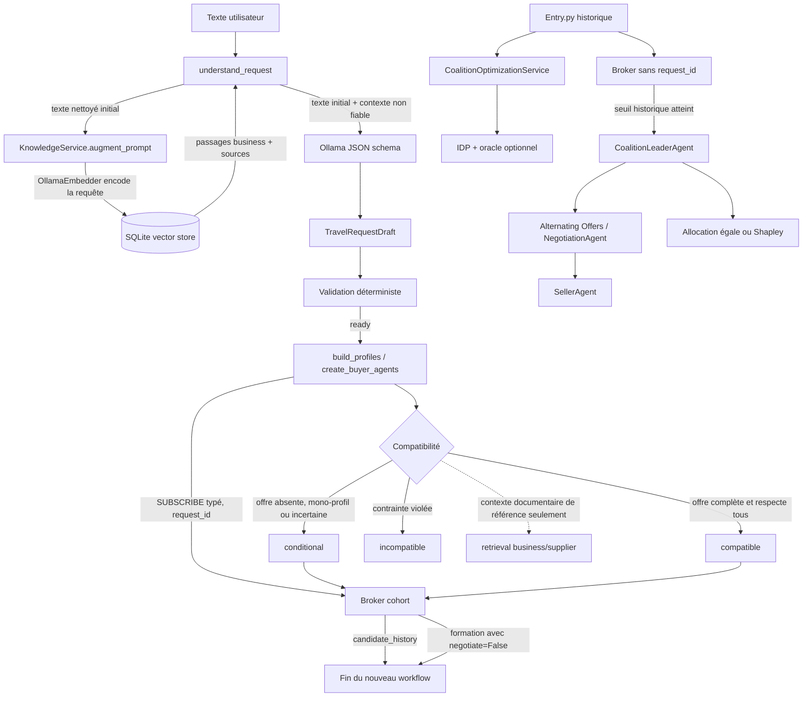
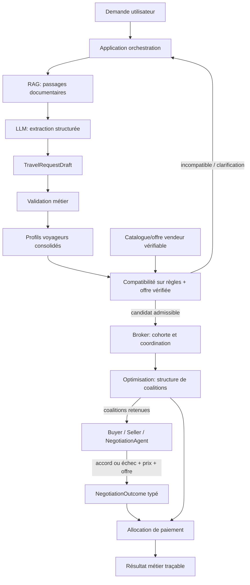

# Phase 3G — Évaluation et cartographie

## État de l'expérience

Les jeux ajoutés sont des fixtures synthétiques, pas un échantillon représentatif du trafic. Les annotations sont des références manuelles à faire relire par le métier avant une sélection de modèle. Le dataset historique `data/eval/request_extraction.jsonl` reste présent; les commandes utilisent désormais `request_extraction_v2.jsonl` (26 exemples) et son manifeste. Le jeu profil dédié comporte 7 exemples. Le corpus RAG possède 12 passages (4 par domaine) et les jugements couvrent 12 requêtes avec des grades 0–3. Les manifests définissent les versions, le caractère synthétique et les limites.

### Exécuter les évaluations

Depuis la racine, avec l'environnement Python du projet activé :

```bash
python -m evaluate_requests --validate-only
python -m evaluate_requests --task profiles --validate-only
OLLAMA_MODEL='<tag exact>' python -m evaluate_requests --output results/extraction.json
OLLAMA_MODEL='<tag exact>' python -m evaluate_requests --task profiles --output results/profiles.json
python -m evaluate_retrieval --validate-only
OLLAMA_EMBEDDING_MODEL='<tag exact>' python -m evaluate_retrieval \
  --database results/index-<tag>.sqlite \
  --model-digest '<digest si disponible>' \
  --top-k 1,3,5 --thresholds 0,0.2,0.4 \
  --output results/retrieval-<tag>.json
```

L'évaluation RAG refuse d'écraser une base existante; utiliser une nouvelle base par modèle et répétition. Le digest est facultatif mais, s'il est fourni, il entre dans la signature de l'espace vectoriel SQLite. Les dimensions égales ne permettent jamais de mélanger deux modèles. Le manifeste du corpus fixe le chunk size de référence à 1200 et l'overlap à 0, ce qui donne un chunk par fixture. Les qrels annotent ces passages documentaires; pour balayer un autre chunking, le CLI regroupe les résultats au niveau du document source et ne compte chaque passage qu'une fois. La validation refuse les documents inconnus.

### Métriques

L'extraction conserve exact match par demande et par champ. Elle rapporte aussi l'exactitude du nombre de profils, du multiensemble des effectifs, des contraintes et des profils complets. Les IDs techniques et l'ordre ne comptent pas dans la comparaison des profils; les effectifs et contraintes restent déterminants. Les labels `ready`, `needs_clarification`, `invalid` et `extraction_error` ont une matrice de confusion; les précisions/rappels de clarification et d'invalidité sont calculés séparément. Les appels en erreur typée restent des erreurs visibles et sont des échecs pour les métriques de contenu. Une réponse conforme au schéma ne garantit pas la correction sémantique.

Pour le retrieval, Precision@K utilise K comme dénominateur, Recall@K le nombre de jugements pertinents (grade > 0), MRR le rang du premier passage de grade positif et nDCG les gains gradués `2^grade - 1`. Les résultats sont macro-moyennés sur les requêtes, avec latence et ventilation par domaine. Les seuils 0, 0.2 et 0.4 sont des points de balayage, pas des seuils recommandés. Le petit corpus synthétique permet de vérifier l'outillage, pas d'établir une conclusion statistique ni une pertinence générale.

Chaque résultat inclut un UUID, date UTC, hash du JSONL, version du manifeste, commit et indicateur dirty lorsque Git est lisible, modèle/configuration, paramètres, latences, erreurs et métriques. Pour l'extraction, le tag de modèle et le digest sont renseignés par l'opérateur dans le lancement; le tag n'est pas une version immuable. La version du prompt et les options température/seed sont émises par l'adaptateur. Aucun secret n'est enregistré. La recherche de provenance remonte à la racine qui contient `.git`.

## Résultats réellement disponibles dans cet environnement

Les validations locales de format de données et les tests unitaires ne réalisent aucune inférence. Aucun score réel d'extraction, de profils ou de retrieval ne peut être rapporté avant l'exécution avec les modèles. Sur cette machine, `ollama` n'est pas installé, `OLLAMA_MODEL` n'est pas défini et le service localhost:11434 ne répond pas. Aucun modèle n'a été téléchargé et aucune qualité ou latence de modèle n'est revendiquée. Les mesures à venir devront comparer plusieurs exécutions réellement effectuées, et distinguer la latence d'indexation de celle des requêtes.

Les points de seuil du CLI sont fournis pour le balayage seulement. Aucun seuil n'est retenu dans cette phase. Les annotations actuelles sont synthétiques et très peu nombreuses; même un résultat parfait sur ce set ne justifierait pas un seuil de production.

## Flux réellement implémenté



`understand_request` passe le texte utilisateur nettoyé tel quel à `augment_prompt`; aucun LLM ne réécrit la requête avant l'embedding. Ollama ne reçoit pas seulement les passages : l'adaptateur reçoit le texte initial, la date de référence et le contexte récupéré, puis renvoie le contrat structuré. Le prompt marque le contexte comme non fiable et interdit d'en déduire une disponibilité ou un prix actuel.

`build_profiles` résout les contraintes communes et spécifiques, consolide les contraintes effectives identiques au sein d'une demande et crée les BuyerAgents. La compatibilité est déterministe. Sans offre commune vérifiable, le résultat est conditionnel; les passages RAG peuvent ajouter des références aux raisons, mais ne changent pas le statut. `compatible` exige une offre complète qui satisfait chaque profil. Un texte documentaire fournisseur n'est jamais une offre disponible.

Le nouveau workflow transmet au Broker une décision applicative `CompatibilityResult` typée et les profils, groupés par `(destination, request_id)`. Le broker enregistre les cohortes et candidats. Il appelle `form_coalition(..., negotiate=False)` uniquement lorsque l'offre commune est déjà compatible; l'appel forme la coalition et avertit les membres, sans créer de CoalitionLeaderAgent ni lancer de négociation. Les autres résultats restent dans l'historique des candidats/compatibilités.

Dans le parcours historique `Entry.py`, les souscriptions sans `request_id` rejoignent la file par destination. Lorsque le seuil configuré est atteint, Broker crée un `CoalitionLeaderAgent`; celui-ci utilise le protocole historique d'offres alternées avec le SellerAgent et peut ensuite répartir le prix, y compris via Shapley. DP/IDP/IP et l'oracle calculent des partitions à partir d'une fonction de valeur; `CoalitionOptimizationService` appelle IDP et peut vérifier avec l'oracle. Ces résultats d'optimisation ne sont pas raccordés au nouveau `TravelWorkflow` et ne déclenchent pas à eux seuls l'achat ou la négociation.

## Cible proposée pour la Phase 3H (pas encore implémentée)



Avant cette cible, il manque des contrats explicites pour : (1) l'offre fournisseur vérifiable, son identifiant/version et son statut de disponibilité; (2) la conversion d'un `TravelRequestDraft` validé vers le problème de coalition et la fonction de valeur; (3) les rôles Broker/optimiseur dans le choix d'une structure sans confondre compatibilité documentaire et faisabilité commerciale; (4) le déclenchement et la politique d'arrêt de la négociation; (5) un `NegotiationOutcome` contenant acceptation/échec, offre exacte, prix total, participants et causes; (6) le contrôle des contraintes de chacun et l'allocation à partir de cet outcome; (7) l'idempotence, les erreurs partielles et la persistance de bout en bout. La cible doit conserver le protocole Buyer/Seller/Negotiation et ne déléguer au LLM ni compatibilité, ni optimisation, ni décision de prix.

## Recommandation Phase 3H

Procéder par petits contrats testables : définir les DTO d'offre et de résultat de négociation; écrire un adaptateur du résultat de profils vers les entrées existantes d'optimisation; faire d'abord un test de bout en bout avec vendeur simulé déterministe; ajouter ensuite l'orchestration Broker pour les cohortes `request_id`; valider acceptation, rejet, absence d'offre, plafond individuel, idempotence et échec d'un membre; enfin comparer le comportement historique `Entry.py`. Ne pas fusionner la compatibilité conditionnelle avec une décision d'achat et ne pas modifier DP/IDP/IP sans un défaut concret démontré.
