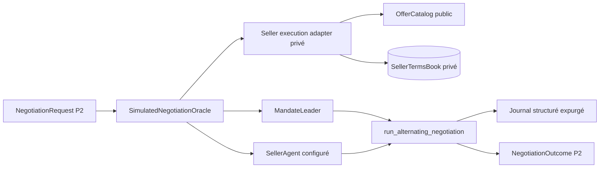

# Phase P3 — moteur de négociation simulée

## 1. Architecture

P3 fournit un adaptateur concret du protocole P2. Il reçoit une requête déjà
formée, vérifie qu'elle correspond au catalogue public et à son registre vendeur
privé, instancie des agents frais, exécute le routeur alterné historique et
retourne le `NegotiationOutcome` P2. Il ne forme aucune coalition et n'effectue
aucune optimisation.



`simulated_oracle.py` est l'unique module P3 autorisé à référencer
`SellerTermsBook`, `SellerTerms`, `SellerFloorTier` ou un plancher. `MandateLeader`
ne reçoit que la requête P2, ses représentants BuyerAgent et une stratégie
acheteur versionnée.

## 2. Contrat P2 respecté

`SimulatedNegotiationOracle.negotiate(request)` retourne exactement
`NegotiationOutcome`, avec les seuls statuts P2 `agreement`, `rejected` et
`turn_limit`. Un accord contient `agreed_total_cents`; les autres statuts ont
un montant nul. `request_key` est conservé, `turns` est un entier non négatif et
`oracle_configuration_id` reste identique pour toutes les offres traitées par
une même configuration d'oracle. Aucun type `NegotiationAttempt` ni contrat
concurrent n'a été ajouté.

L'adaptateur revalide le type exact de la requête, ses unités, son offre, sa
quantité, sa réservation et sa clé. Il vérifie la correspondance de l'offre
avec le catalogue chargé, la provenance catalogue/termes, l'existence du terme
privé et la cohérence du palier choisi. Les classes d'erreurs distinguent
requête invalide, offre inconnue, termes absents, provenance incohérente,
configuration invalide, erreur d'agent et divergence de reproductibilité.

## 3. Montants et stratégie

Tous les calculs métier sont en centimes totaux jusqu'à la frontière des agents
historiques. La conversion utilise exclusivement `to_agent_amount` et
`from_agent_amount` de P1.

Le prix public de `OfferQuote` est un tarif catalogue **par siège**. Le prix
initial du vendeur est donc `offer.list_total(request.seats)` : le tarif du
palier public multiplié une seule fois par le nombre total de sièges. Cette
règle conserve le prix catalogue comme référence visible et n'ajoute aucun
coefficient commercial initial. Le prix initial retenu et sa politique
`public-list-total-v1` sont inclus dans la configuration et le journal.

Le plancher par siège privé est multiplié une seule fois par `request.seats`
via `SellerTerms.floor_total`. Le `SellerAgent` reçoit ce plancher total et le
total catalogue initial. La validation P1 garantit que le plancher par siège ne
dépasse pas le prix public correspondant.

Le mandat utilise exclusivement `request.reservation_cents`, somme additive
P2. La stratégie acheteur est `mandate-leader-total-v1` : point de départ
interne à 60 % de la réservation, concessions de 10 %, plafond de réservation et
six contre-offres au maximum. Ces valeurs sont des paramètres Decimal/int nommés
et figurent dans la configuration. Les acheteurs de profil sont créés pour
préserver les représentants historiques, mais leurs budgets ne sont pas
additionnés ou relus par le leader. Le point de départ (`initial_leader_total_cents`
du journal) n'est jamais envoyé : la première proposition reçue par le vendeur
vaut déjà 0,6 × 1,1 × R, exactement comme dans `CoalitionLeaderAgent`.

**Règle de décision (P3-bis).** Pendant la négociation, les deux participants
décident sur les flottants bruts échangés, comme les agents historiques :
le leader accepte si `prix <= to_agent_amount(reservation_cents)` (historique :
`seller_price <= self.budget`), le vendeur accepte si `offre >= min_price`
(historique : `buyer_offer >= self.min_price`) et renvoie l'offre brute. Les
centimes ne servent qu'à valider les prix entrants et à convertir une seule fois
le prix accepté final par `from_agent_amount`. Arrondir avant de comparer
changeait la trajectoire aux bornes d'arrondi (voir `PHASE_P3_BIS_FIDELITY.md`).
L'arrondi étant monotone et `from_agent_amount(to_agent_amount(c)) == c`, tout
accord vérifie plancher ≤ montant ≤ réservation en centimes ; l'oracle le vérifie
quand même.

Le vendeur conserve le constructeur et le protocole CFP de `SellerAgent`. Pour
les propositions, `_ConfiguredSellerAgent` reproduit la règle historique et ne
remplace que le littéral 0,90 par le facteur `seller_concession_factor(rate) =
float(1 - rate)`, arrondi une seule fois depuis Decimal ; pour le taux par défaut
il vaut exactement 0,90. De même, le facteur du leader `float(1 + rate)` vaut
exactement 1,10. La version de ces stratégies et leurs paramètres participent à
l'identifiant de configuration.

## 4. Routage, journal et confidentialité

`run_alternating_negotiation` retourne le nombre d'appels d'agents qu'il a
routés. Ce nombre est repris dans le champ contractuel P2 `turns` et nommé
`router_iterations` dans le journal. Il n'est pas présenté comme un nombre de
tours complets vendeur-acheteur.

Chaque invocation est journalisée avec son index, l'acteur, les types de
messages et les prix totaux en centimes. Le journal contient aussi l'offre, le
palier public, les montants initiaux, le statut terminal, le motif d'échec et
l'empreinte SHA-256 du journal canonique. Il ne contient aucun objet de termes
privés ni champ de plancher.

Les agents historiques écrivent directement sur `stdout` et peuvent imprimer
le plancher. L'oracle capture puis abandonne ces sorties brutes ; seul le
journal structuré expurgé est renvoyé. `redirect_stdout` modifie le flux global
du processus : les appels P3 doivent être exécutés séquentiellement. Cette
implémentation ne prétend pas être thread-safe.

## 5. Identifiants et reproductibilité

`oracle_configuration_id` est un SHA-256 canonique stable pour la configuration
complète d'un lot P2 : versions du protocole et stratégies, paramètres, date de
référence, limite d'itérations, empreintes du catalogue et du registre privé,
et empreintes des sources historiques/P3 utilisées, y compris le convertisseur
monétaire P1, les contrats d'offre/requête et le chargeur du catalogue. Le
contrat P2 impose que
cet identifiant soit commun à toutes les offres d'un lot.

Le `run_id` du journal distingue chaque exécution en ajoutant la clé de requête,
l'offre, la quantité, le palier et le tarif public du palier sélectionné. Cette
séparation conserve la stabilité requise par P2 tout en traçant l'offre et le
palier de chaque tentative. Aucun timestamp ni valeur aléatoire n'entre dans
ces identifiants.

Par défaut, chaque appel est exécuté deux fois avec des agents frais. Statut,
montant, nombre d'itérations et empreinte du journal doivent correspondre ;
sinon l'oracle lève `NonDeterministicSimulationError`. Il n'y a pas de cache.

## 6. Interfaces historiques réutilisées et limites

P3 réutilise `Agent`, `BuyerAgent`, le constructeur/CFP de `SellerAgent`,
`Message` et `run_alternating_negotiation`. Le `CoalitionLeaderAgent` historique n'est pas
réutilisé : il calcule un plafond à partir des budgets individuels, effectue
Shapley/allocation et déclenche des effets de bord. `MandateLeader` reproduit
exactement sa méthode `receive_message`. Le `BrokerAgent`, la formation de
groupes, `negotiate_for_group`, DP/IDP et les composants P4 ne sont pas appelés.

À R, F et I égaux, P3 produit le même statut, le même montant, le même nombre
d'itérations et les mêmes flottants échangés que les agents historiques ; c'est
testé dans `tests/test_simulated_negotiation_fidelity.py`. Les différences avec
`negotiate_for_group` portent uniquement sur les **paramètres** et sont des choix
de spécification :

| Paramètre | Historique | P3 |
|---|---|---|
| Réservation R | min(budget total, plus petit plafond par personne × quantité) | Σ B_u additive (P2) ; identique si les budgets par personne sont égaux |
| Prix initial vendeur I | 1,4 × `group_min_fare` × q × (1 − remise) | total catalogue public du palier |
| Plancher F | `group_min_fare` × q × (1 − remise) | `SellerTerms.floor_total(q)` privé |
| Limite du routeur | 30 | 30 |

**Statuts et raisons de fin.** Les statuts restent ceux de P2. Le journal ajoute
une `terminal_reason` fermée, déduite de l'expéditeur du message final :

| Statut P2 | `terminal_reason` | Condition |
|---|---|---|
| `agreement` | `None` | ACCEPT final ; F ≤ montant ≤ R en centimes |
| `rejected` | `leader_counteroffers_exhausted` | REJECT du leader après plus de `max_counteroffers` refus (vérifié) |
| `rejected` | `seller_rejected` | REJECT du vendeur ; réservé, impossible avec le `SellerAgent` historique qui n'a pas de branche REJECT |
| `turn_limit` | `router_iteration_limit` | le routeur renvoie `None` après exactement `max_router_iterations` itérations |

Un agent muet, un REJECT du leader avant épuisement, un message final d'un
expéditeur inconnu, un arrêt du routeur avant sa limite ou un accord hors
[F, R] lèvent `AgentExecutionError` ; une erreur d'agent n'est jamais
transformée en statut, en accord ou en prix. `NegotiationJournal` refuse toute
combinaison statut / raison / montant / nombre d'événements incohérente.

Avec la stratégie par défaut, la sixième contre-offre atteint le plafond
(0,6 × 1,1⁶ ≈ 1,063 ≥ 1). Donc `rejected` ⇔ F > R : un rejet signifie qu'aucun
prix n'est acceptable pour les deux parties, et non un abandon stratégique
alors qu'un accord était possible. Une négociation dure au plus
2 × (6 + 1) = 14 itérations, donc `turn_limit` ne peut pas se produire avec la
limite de 30 ; il n'apparaît que si la limite est configurée sous 14. Une autre
stratégie (0,6 × (1 + r)^k < 1) peut rejeter malgré un accord possible ; elle a
alors un autre `oracle_configuration_id`. Pour P4, `rejected` et `turn_limit`
signifient tous deux qu'il n'y a pas d'accord sur cette offre ; une coalition
sans accord sur aucune de ses offres communes n'est pas réalisable (voir
`docs/PHASE_P4_SPECIFICATION.md` §3). La distinction reste un diagnostic.

Les unités ou requêtes dont les réservations dépassent le domaine monétaire P1
sont rejetées. Les paliers manquants sont impossibles dans des objets P1 valides
(paliers triés, premier seuil égal à un, quantité dans la capacité) ; une
incohérence de catalogue/termes est néanmoins rejetée avant toute simulation.
Le type `SellerTerms` ne porte pas de fournisseur : la cohérence fournisseur
est vérifiée en exigeant que l'`OfferQuote` de la requête soit strictement égal
à l'entrée publique du catalogue portant le même identifiant, puis en validant
le registre privé complet contre ce catalogue. Le SHA du catalogue est calculé
sur les octets par le chargeur P1 ; l'oracle attend les objets publics/privés
produits par ce chargeur de confiance.

## 7. Tests

`tests/test_simulated_negotiation_oracle.py` couvre l'adaptateur privé, les
réservations additives, les prix par siège convertis en totaux une seule fois,
mandats singleton et collectifs, profils multiples dans une unité, limite de
capacité, accord égal à la réservation, plancher supérieur à la réservation,
offre inconnue, provenance/termes incohérents, erreurs d'agents, statuts P2,
journal expurgé, capture console, appels P2 réels, identifiants stables et
répétition A/B/A. `tests/test_offer_catalog.py` autorise uniquement le module
`simulated_oracle.py` en plus des deux composants P1 déjà autorisés.

`tests/test_simulated_negotiation_fidelity.py` (P3-bis) compare l'oracle et ses
agents aux agents historiques réels : 6 scénarios fixes (un voyageur, quatre
voyageurs, plancher supérieur à la réservation, prix catalogue égal à la
réservation, deux bornes d'arrondi), deux familles de 60 bornes générées, 300
scénarios aléatoires, puis la sémantique des statuts, les raisons de fin et les
invariants du journal.

## 8. Fichiers et vérifications (P3 initial, Codex)

Les résultats ci-dessous sont ceux du P3 initial. Les résultats après P3-bis
sont en section 9.

Fichiers créés :

- `Multi-Agent/coalition_travel/infrastructure/negotiation/__init__.py`
- `Multi-Agent/coalition_travel/infrastructure/negotiation/mandate_leader.py`
- `Multi-Agent/coalition_travel/infrastructure/negotiation/simulated_oracle.py`
- `tests/test_simulated_negotiation_oracle.py`
- `docs/PHASE_P3_SIMULATED_NEGOTIATION.md`

Fichier existant modifié : `tests/test_offer_catalog.py`, uniquement pour
ajouter `simulated_oracle.py` à la liste blanche de confidentialité.

### Résultats exécutés sur le dépôt local

Inventaire initial : `HEAD=f2cef07`; `tests/test_python310_compatibility.py`
était déjà modifié et les fondations/tests P2 ainsi que les documents et archives
personnels étaient déjà non suivis. Le cache d'index était vide. Aucun de ces
fichiers préexistants n'a été écrasé. Après P3, le seul nouveau changement suivi
est l'ajout d'une entrée à la liste blanche dans `tests/test_offer_catalog.py`;
les deux nouveaux modules, leur package, le test P3 et ce rapport sont non
suivis. Les historiques, le Golden Master et le catalogue sont inchangés.

Commandes et sorties réelles :

```text
PYTHONHASHSEED=0 PYTHONDONTWRITEBYTECODE=1 .venv/bin/python -m pytest -p no:cacheprovider -q
492 passed in 6.09s

PYTHONHASHSEED=2 PYTHONDONTWRITEBYTECODE=1 .venv/bin/python -m pytest -p no:cacheprovider -q
492 passed in 6.09s

.venv/bin/pytest -q tests/test_simulated_negotiation_oracle.py
31 passed in 0.08s

.venv/bin/pytest -q tests/test_entry_golden_master.py
4 passed in 3.04s

.venv/bin/pytest -q tests/test_simulated_negotiation_oracle.py tests/test_offer_catalog.py tests/test_agents.py tests/test_entry_golden_master.py tests/test_python310_compatibility.py
123 passed in 4.64s

.venv/bin/ruff check Multi-Agent/coalition_travel/infrastructure/negotiation/mandate_leader.py Multi-Agent/coalition_travel/infrastructure/negotiation/simulated_oracle.py tests/test_simulated_negotiation_oracle.py tests/test_offer_catalog.py
All checks passed!

.venv/bin/ruff format --check Multi-Agent/coalition_travel/infrastructure/negotiation/mandate_leader.py Multi-Agent/coalition_travel/infrastructure/negotiation/simulated_oracle.py tests/test_simulated_negotiation_oracle.py tests/test_offer_catalog.py
4 files already formatted

git diff --check
(aucune sortie ; code de sortie 0)
```

Ruff sur tout le dépôt local ne passe pas sans toucher à l'historique : `ruff
check .` rapporte quatre problèmes d'imports/inutilisé dans `Multi-Agent/Entry.py`,
`Multi-Agent/Negotiation.py` et `Multi-Agent/SellerAgent.py`. `ruff format
--check --output-format concise .` rapporte neuf fichiers hors P3 à reformater
(dont ces agents historiques et des documents) et 82 fichiers formatés. Ces
fichiers n'ont pas été changés, conformément au périmètre.

`git diff --stat` après P3 montre les six insertions suivies : une ligne dans
`tests/test_offer_catalog.py` et les cinq lignes P2 préexistantes dans
`tests/test_python310_compatibility.py`. Le diff indexé est vide. Les contrôles
de 18 fichiers historiques, du catalogue et de la référence Golden Master
confirment qu'ils sont inchangés. Aucun commit, push, Golden Master généré ou
changement P4 n'a été effectué.

P3 n'ajoute aucune API réelle, réservation réelle, base de données, fournisseur
LLM ou optimisation de coalition. P4 reste hors périmètre.

## 9. Correctif P3-bis

P3-bis corrige la fidélité des comparaisons de prix, type la raison de fin et
ajoute les tests de comparaison avec l'historique. Le contrat P2, les champs de
configuration, les versions de stratégie, les fichiers historiques, le catalogue
et le Golden Master sont inchangés. Le détail (défauts, corrections, preuves,
tests, mutants, consignes) est dans `docs/PHASE_P3_BIS_FIDELITY.md`.

La décision suivante sur `request_key` (identité économique du mandat, voir
`docs/PHASE_P2_ADMISSIBILITY.md` §13) ne change pas le contrat de l'oracle ;
elle change `oracle_configuration_id`, qui inclut l'empreinte du module
`negotiation_request`. Résultats finaux :

```text
PYTHONHASHSEED=0 python -m pytest -q
545 passed
PYTHONHASHSEED=2 python -m pytest -q
545 passed
ruff check Multi-Agent/coalition_travel tests
All checks passed!
ruff format --check Multi-Agent/coalition_travel tests
67 files already formatted
```
